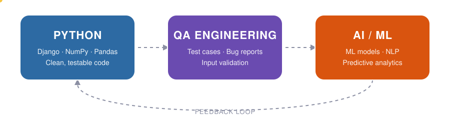

<div align="center">

<h1 align="center"></h1>

<picture>
  <source media="(prefers-color-scheme: dark)" srcset="https://readme-typing-svg.demolab.com?font=Fira+Code&weight=600&size=24&duration=2800&pause=900&color=C4A9FF&center=true&vCenter=true&width=640&height=45&lines=Python+Developer;QA+Engineer;AI+%2F+ML+Builder;Build+it.+Break+it.+Make+it+smarter." />
  <source media="(prefers-color-scheme: light)" srcset="https://readme-typing-svg.demolab.com?font=Fira+Code&weight=600&size=24&duration=2800&pause=900&color=5B3FA0&center=true&vCenter=true&width=640&height=45&lines=Python+Developer;QA+Engineer;AI+%2F+ML+Builder;Build+it.+Break+it.+Make+it+smarter." />
  
</picture>

<sub>📍 Mumbai, India &nbsp;·&nbsp; 🎓 MCA @ Bharati Vidyapeeth</sub>

<br>


<a href="https://www.linkedin.com/in/khushichile"></a>
<a href="mailto:khushichile2004@gmail.com"></a>
<a href="https://khushi-chile.netlify.app"></a>

</div>


<h2 align="center">👋 Hi, I'm Khushi</h2>

<p align="center">
I'm an <b>MCA student at Bharati Vidyapeeth (2025–2027)</b> based in Mumbai.<br/>
I like the full loop of software: <b>build it</b>, <b>break it</b>, then <b>make it smarter</b>.<br/>
My work sits where Python, quality engineering and machine learning meet.
</p>

```python
class Khushi:
    focus    = ["Python", "QA Engineering", "AI / ML"]
    builds   = ["ML platforms", "NLP chatbots", "full-stack apps"]
    believes = "If it isn't tested, it isn't finished."
    status   = "Open to internships, full-time roles and collaborations"
```


<h2 align="center">🧬 How my skills connect</h2>

<div align="center">



</div>


<h2 align="center">🚀 Projects</h2>

<div align="center">

<table width="100%">
<tr>
<td align="center" valign="top" width="50%">
<h3 align="center">📚 AI-Powered Literature Review System</h3>


<p>Helps researchers work through papers faster, from analysis and hypothesis generation to synthesis.</p>
🔍 Research paper analysis<br/>
💡 Hypothesis generation<br/>
🧭 Novelty detection<br/>
🧩 Evaluation, comparison &amp; synthesis
</td>
<td align="center" valign="top" width="50%">
<h3 align="center">🎓 EduGuard: Student Dropout Prediction</h3>


<p>Uses machine learning to identify at-risk students so that help can arrive early.</p>
📉 Dropout prediction with ML<br/>
📊 Educational analytics<br/>
🚨 Spots at-risk students<br/>
🤝 Early intervention support
</td>
</tr>
<tr>
<td align="center">
<a href="https://github.com/khushi-io/ai-powered-literature-review-system"></a>
</td>
<td align="center">
<a href="https://github.com/khushi-io/eduguard-student-dropout-prediction"></a>
</td>
</tr>
<tr>
<td align="center" valign="top" width="50%">
<h3 align="center">🐾 Smart Pet Care &amp; Adoption System</h3>


<p>A full-stack web app that makes pet adoption and pet care easier.</p>
🤖 NLP chatbot for adoption Q&amp;A<br/>
🔎 Smart matching<br/>
📚 Pet care knowledge base<br/>
🧑‍💻 Built solo, end to end
</td>
<td align="center" valign="top" width="50%">
<h3 align="center">🏥 SmartHealth: Healthcare Management</h3>


<p>An Android app for health records and appointments, built as my BCA final-year project.</p>
🗂️ Health records<br/>
📅 Appointment management<br/>
✅ Input validation<br/>
🧪 QA tested
</td>
</tr>
<tr>
<td align="center">
<a href="https://github.com/khushi-io/smartpetcare"></a>
</td>
<td align="center">
<a href="https://github.com/khushi-io/healthcare-management-android"></a>
</td>
</tr>
</table>

</div>


<h2 align="center">⚡ Toolbox</h2>

<div align="center">

| Area | Tools |
|:---:|:---:|
| **🐍 Python** |     |
| **🤖 AI / ML** |    |
| **🔬 QA** |     |
| **🗄️ Data & BI** |    |
| **🧰 Also** |      |

</div>


<h2 align="center">💼 Experience</h2>

<div align="center">

| Role | Organization | Duration |
|:---:|:---:|:---:|
| **Information Technology Intern** | Mira Bhayandar Municipal Corporation (MBMC) | Aug 2024 – Jan 2025 · 6 months · On-site |

🐞 Found and reported errors on live websites, as hands-on QA in a real environment<br/>
📊 Designed dashboards for managing public infrastructure<br/>
📝 Prepared NIC documentation and reports

</div>


<h2 align="center">🌱 What I'm working on next</h2>

```python
next_up = {
    "AI / ML": "Going deeper into model building, evaluation and NLP",
    "QA":      "Test automation and structured test reporting",
    "Python":  "Advanced Python and cleaner, more testable code",
}

for track, goal in next_up.items():
    print(f"📈 {track}: {goal}")
```


<h2 align="center">📊 GitHub activity</h2>

<div align="center">

<picture>
  <source media="(prefers-color-scheme: dark)" srcset="https://github-readme-stats.vercel.app/api?username=khushi-io&show_icons=true&theme=tokyonight&hide_border=true&bg_color=00000000" />
  <source media="(prefers-color-scheme: light)" srcset="https://github-readme-stats.vercel.app/api?username=khushi-io&show_icons=true&theme=default&hide_border=true&bg_color=00000000" />
  
</picture>
<picture>
  <source media="(prefers-color-scheme: dark)" srcset="https://github-readme-stats.vercel.app/api/top-langs/?username=khushi-io&layout=compact&theme=tokyonight&hide_border=true&bg_color=00000000" />
  <source media="(prefers-color-scheme: light)" srcset="https://github-readme-stats.vercel.app/api/top-langs/?username=khushi-io&layout=compact&theme=default&hide_border=true&bg_color=00000000" />
  
</picture>

<picture>
  <source media="(prefers-color-scheme: dark)" srcset="https://github-readme-streak-stats.herokuapp.com/?user=khushi-io&theme=tokyonight&hide_border=true" />
  <source media="(prefers-color-scheme: light)" srcset="https://github-readme-streak-stats.herokuapp.com/?user=khushi-io&theme=default&hide_border=true" />
  
</picture>

</div>


<h2 align="center">🎓 Education</h2>

<div align="center">

| Degree | Institution | Years |
|:---:|:---:|:---:|
| **MCA** | Bharati Vidyapeeth | 2025 – 2027 |
| **BCA** | SNDTWU (Grade A) | Completed |

</div>

<h2 align="center">🏅 Certifications</h2>

<div align="center">

| Year | Certification |
|:---:|:---:|
| 2025 | Advanced Java |
| 2024 | Power BI |
| 2024 | AI Tools |
| 2023 | Advanced Office Automation |
| 2023 | Adobe Photoshop |
| 2022 | MS-CIT |

<sub>Skill Development &amp; Vocational Training Institute of India · MSBTE</sub>

</div>


<div align="center">

<h3>Recruiting for Python, QA or AI/ML? Let's talk.</h3>

Or maybe you came for a project. Feel free to open an issue, share feedback, or say hi.

<br/>

<a href="https://www.linkedin.com/in/khushichile"></a>
<a href="mailto:khushichile2004@gmail.com"></a>
<a href="https://khushi-chile-portfolio.netlify.app"></a>

<br/><br/>

<sub>🎸 Guitar in the breaks, code in focus mode &nbsp;·&nbsp; ⭐ If a project helped you, a star means a lot!</sub>

</div>
